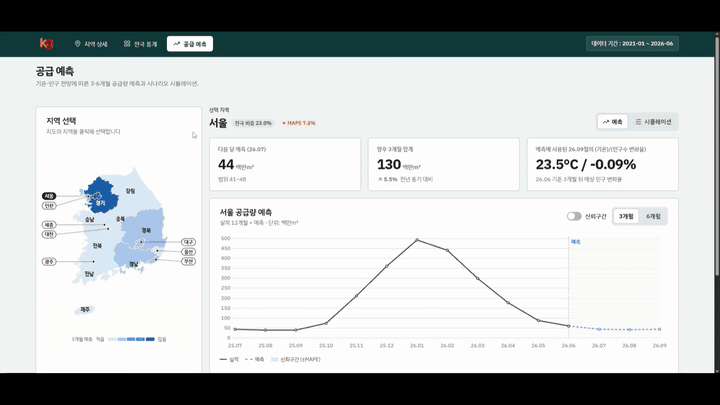
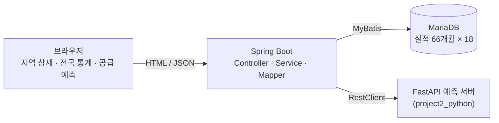

# 가스 공급량 수요 예측 모니터링 대시보드 (Spring Boot)

도시가스 공급량이 **기온 · 인구**와 어떤 관계인지 분석해 **지역 상세 · 전국 통계 · 공급 예측** 화면으로 보여 주는 대시보드입니다.
그린AI캠퍼스 2차 팀 프로젝트(COMMIT, 3인 · 2026.09.18 ~ 10.16)입니다.
이 저장소는 **웹(Spring Boot)** 이고, 예측 서버(FastAPI) 코드는 [project2_python](https://github.com/jinho333/project2_python)에 있고, 이 README에는 웹이 호출하는 API만 적었습니다.

## 제가 맡은 부분

저는 전국 통계 페이지를 주로 맡았습니다. [내 커밋 보기](https://github.com/isnull0x00/project2/commits/dev?author=isnull0x00)

- KPI 카드, 연도별·월별 추이 차트, 지역 트리맵·도넛, 상관표, 예측 오차 카드를 만들고 서비스·DTO·MyBatis 쿼리를 작성했습니다.
- 전국 페이지가 두 API를 차례로 받던 것을 동시에 요청하게 바꿔, 로컬에서 응답 시간을 258ms에서 169ms로 줄였습니다.
- 이 페이지는 예측 서버([project2_python](https://github.com/jinho333/project2_python))의 예측 결과를 받아 보여 줍니다.

### 전국 통계에서 내린 판단

- **예측 오차 경고 기준을 10%로:** 처음 8%였던 기준을 Lewis(1982)의 관례에 맞춰 10%로 올리고, 근거를 화면 설명에 적었습니다.
- **울산이 기준을 넘는 까닭을 화면에 밝힘:** 4월·5월 오차(+33%, +21%)가 컸고 두 달 모두 최근 5년 같은 달 범위보다 공급이 낮았습니다. 이 두 달을 빼면 약 6.7%입니다. 6월 값을 교정한 사실도 함께 적었습니다.
- **상관표를 "전체"와 "같은 달끼리"로 나란히:** 전체로 보면 −0.95인 한 쌍이 같은 달끼리 비교하면 −0.51로 약해졌습니다. 계절 효과를 걷어낸 값도 같이 보여 주려고 두 표를 나란히 두었습니다.
- **요인 카드의 행은 서버 변수 이름에서 생성:** 변수가 늘어도 화면 코드를 고치지 않고 행이 추가됩니다.



> 공급 예측 페이지: 지역을 고르면 다음 달 · 3·6개월 예측과 곡선, 조건을 바꿔 보는 시뮬레이션이 나옵니다.

## 한눈에 보기 (팀 결과)

| | |
|---|---|
| 예측 오차(MAPE) | 전월 기온을 입력에 추가해 **18개 지역 평균 16.7% → 8.4%** (대구 62.5% → 7.3%) |
| 없는 지역 번호 | 통계 200 · 예측/시뮬레이션 500 → **404로 통일**, 공통 검증 메서드 1개 |
| 예측 속도 | 예측 결과를 캐시하고 서버 시작 시 3·6개월을 미리 계산 |
| 데이터 | (17개 시도 + 전국) × 66개월 = 1,188행 (2021.01 ~ 2026.06) |

## 구조



FastAPI는 **보조 서버**입니다. 지역 상세 · 전국 통계는 DB의 실제 값으로 그려, 예측 서버가 멈춰도 화면이 동작하도록 나눴습니다.

## 예측 서버 (FastAPI) — [project2_python](https://github.com/jinho333/project2_python)

시도별 RandomForest 모델로 다음 달 · 3·6개월 공급량을 예측하고, 기온과 인구를 바꿔 보는 시뮬레이션과 지역별 예측 오차(MAPE)를 제공합니다. 이 웹이 아래 API를 `RestClient`로 호출합니다.

| 메서드 | 경로 | 설명 |
|---|---|---|
| GET | `/forecast?region=&horizon=` | 지역별 예측 (같은 요청은 캐시) |
| GET | `/forecast/summary` | 지도 색칠용 요약 |
| GET | `/mape` | 지역별 예측 오차 |
| POST | `/simulation` | 기온 · 인구 시뮬레이션 |

## 핵심 코드

| 주제 | 위치 |
|---|---|
| 공통 검증 `checkRegion()` | [`RegionService.java`](src/main/java/com/commit/project2/service/RegionService.java#L91) |
| API 진입 시점 호출 | [`ForecastApiController.java`](src/main/java/com/commit/project2/controller/ForecastApiController.java#L24) |
| 요청 번호로 옛 응답 버리기 | [`region.js`](src/main/resources/static/js/region.js#L105) |

```java
public void checkRegion(Long regionId) {
  String name = regionMapper.getRegionName(regionId);   // 없는 번호면 null
  if (name == null) {
    throw new ResponseStatusException(HttpStatus.NOT_FOUND, "없는 지역 번호입니다: " + regionId);
  }
}
```

## 기술 스택

Java 17 · Spring Boot · MyBatis · Thymeleaf · MariaDB · JavaScript(axios) · Chart.js · RestClient · Gradle

## 실행

1. MariaDB `project-2` 데이터베이스를 준비하고 [project2_python](https://github.com/jinho333/project2_python)의 CSV 데이터를 적재합니다. (스키마 SQL은 이 저장소에 없습니다.)
2. 예측 서버를 먼저 실행합니다(기본 주소 `http://localhost:8000`, `application.yaml`의 `py.base.url`).

```bash
git clone https://github.com/jinho333/project2_python
cd project2_python
pip install fastapi uvicorn pandas scikit-learn joblib
python train.py    # 처음 또는 모델을 바꿨을 때
python main.py     # http://localhost:8000
```
3. `application.yaml`의 DB 접속 정보를 본인 환경에 맞게 고치고 실행합니다.

```bash
./gradlew bootRun
```

## 한계와 다음 단계

- 예측 캐시는 서버 시작 시 채워집니다. 값을 바꿨을 때 재시작 없이 갱신하는 **갱신 정책**이 없습니다.
- 404를 받은 화면이 "없는 지역"임을 알려 주지 않습니다.
- 학습 데이터가 5~6년이라 해석에 한계가 있고, 울산은 10% 이상(10.1%)으로 남았습니다.
- 울산 2026년 6월 값이 5월과 같아 이전 연도 평균(9,441천㎥)으로 교정했습니다. 원본이 아닌 교정값입니다.

## 기록

- [프로젝트 작업 일지 (Notion)](https://fluffy-plane-19c.notion.site/3e3a969c48278070bbaaf5dee74b31b4)
