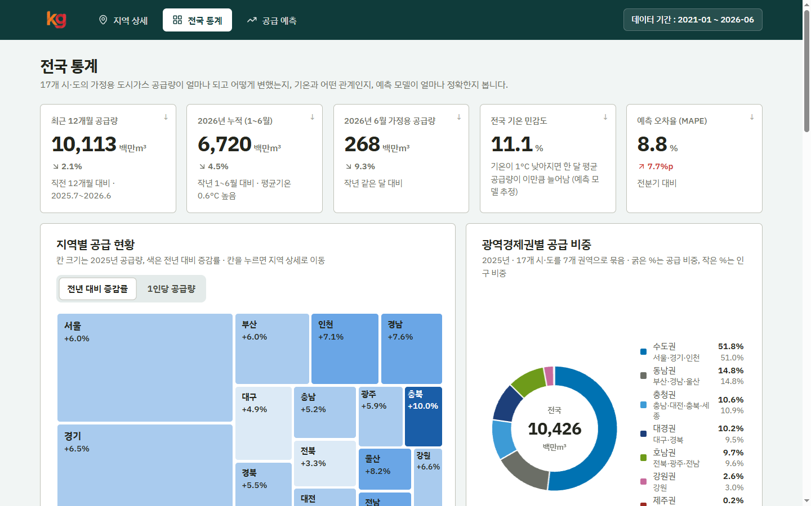
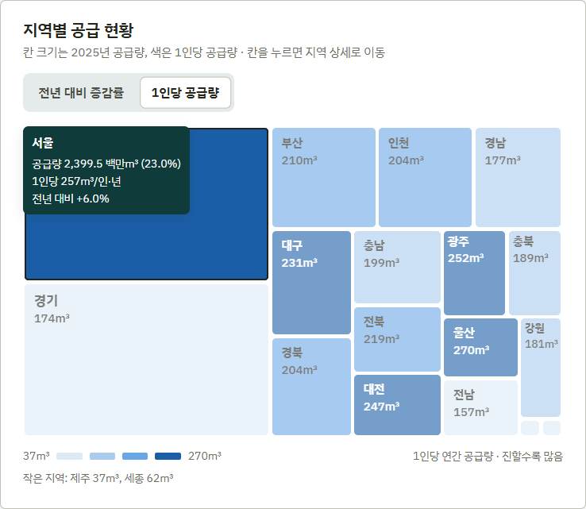
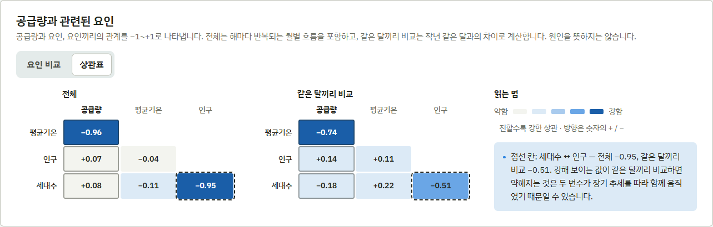
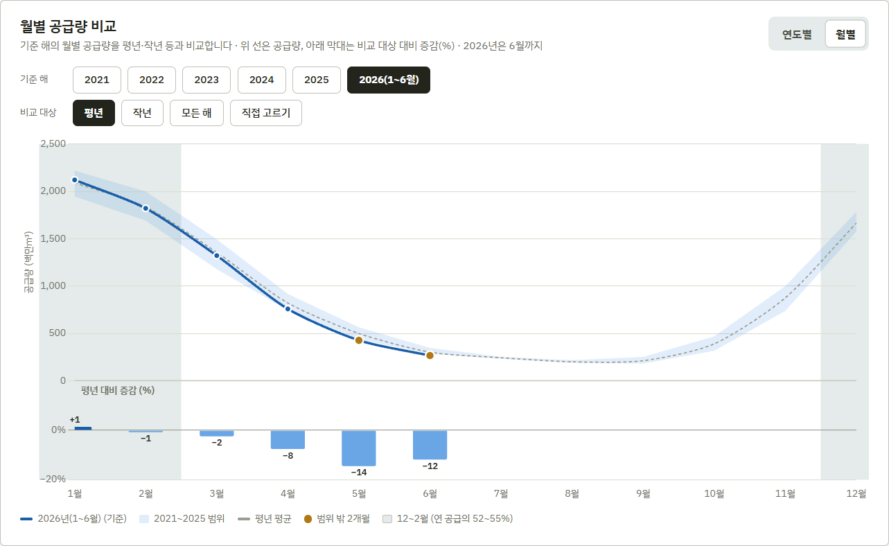
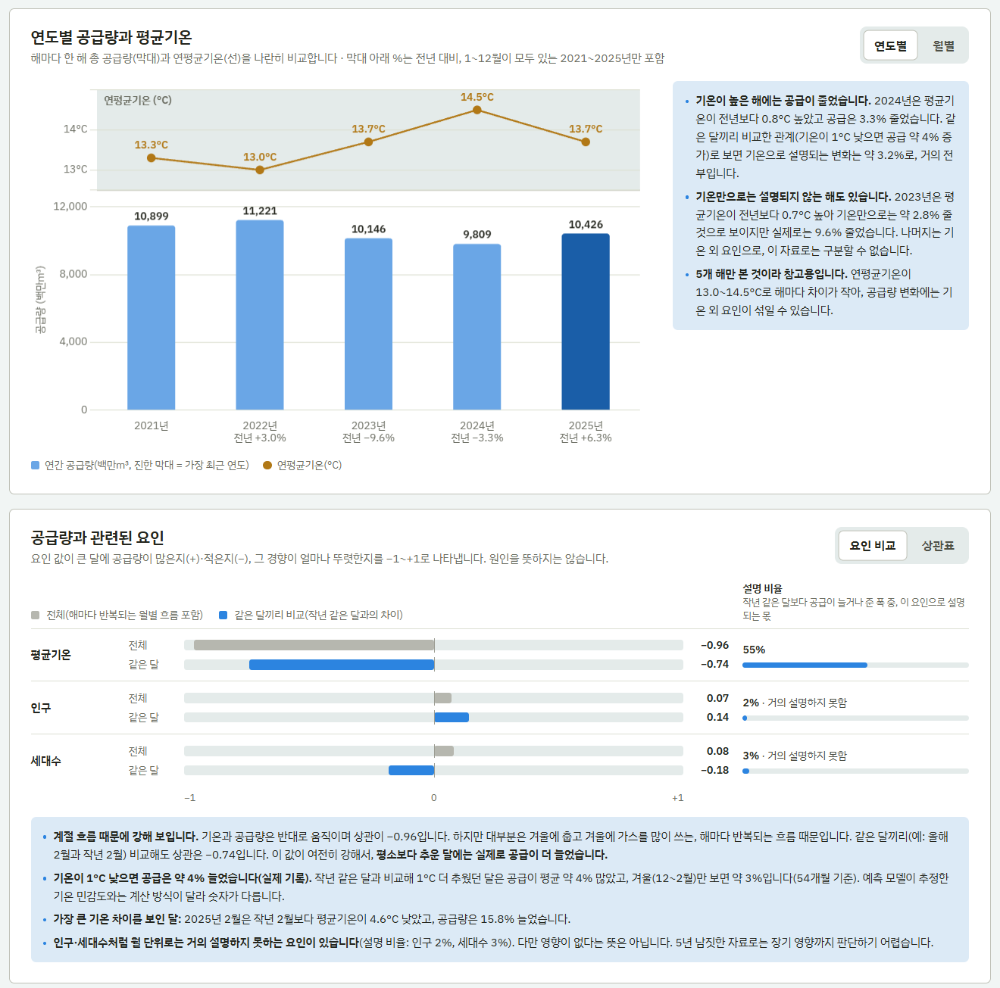
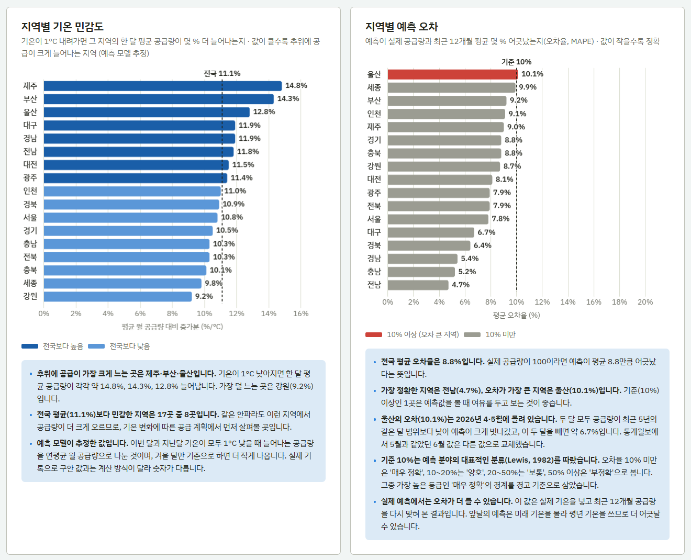
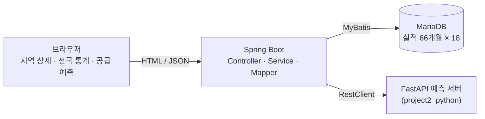

# 가스 공급량 수요 예측 모니터링 대시보드 (Spring Boot)

도시가스 공급량이 **기온 · 인구**와 어떤 관계인지 분석해 **지역 상세 · 전국 통계 · 공급 예측** 화면으로 보여 주는 대시보드입니다.
그린AI캠퍼스 2차 팀 프로젝트(COMMIT, 3인 · 2026.09.18 ~ 10.16)입니다.
이 저장소는 **웹(Spring Boot)** 이고, 예측 서버(FastAPI) 코드는 [project2_python](https://github.com/jinho333/project2_python)에 있고, 이 README에는 웹이 호출하는 API만 적었습니다.

     

## 전국 통계 페이지

이 저장소에서 저는 **전국 통계 페이지**를 구현했습니다.
[내 커밋 보기](https://github.com/isnull0x00/project2/commits/dev?author=isnull0x00)

| 구현 | 결과 (조건) |
|---|---|
| KPI 카드, 연도별·월별 추이, 지역 트리맵·도넛, 상관표, 예측 오차 카드 | 같은 화면에서 토글로 전환 (전년 대비 ↔ 1인당, 연도별 ↔ 월별, 요인 비교 ↔ 상관표) |
| 두 API 동시 요청 | 두 API가 모두 끝나는 시점 258ms → 169ms (로컬 측정) |
| 값이 비거나 계산할 수 없을 때의 처리 | 0.0 대신 빈 값(null)으로 돌려 화면이 가짜 0을 보이지 않게 함, 테스트 6개 |
| 예측 서버 장애 대비 | 예측 서버가 꺼져도 전국 페이지의 나머지는 표시 |

### 화면에서 내린 판단

- **예측 오차 경고 기준을 10%로:** 처음 8%였던 기준을 Lewis(1982)의 관례에 맞춰 10%로 올리고, 근거를 화면 설명에 적었습니다.
- **울산이 기준을 넘는 까닭을 화면에 밝힘:** 4월·5월 오차(+33%, +21%)가 컸고 두 달 모두 최근 5년 같은 달 범위보다 공급이 낮았습니다. 이 두 달을 빼면 약 6.7%입니다. 6월 값을 교정한 사실도 함께 적었습니다.
- **상관표를 "전체"와 "작년 같은 달과의 차이"로 나란히:** 전체로 보면 −0.95인 한 쌍이 같은 달끼리 비교하면 −0.51로 약해졌습니다. 계절 효과를 걷어낸 값도 같이 보여 주려고 두 표를 나란히 두었습니다.
- **같은 11.1%가 분모에 따라 의미가 두 배 달라짐:** 재계산으로 11.1 대 5.3 대 관측 3.9를 찾아, 숫자는 두고 문구를 "평균 월 공급량 대비 증가분"으로 바로잡았습니다.
- **권역을 정부 5+2 광역경제권 7개로:** 임의 5개로 나눈 것을 구분 근거를 설명할 수 있게 바꿨습니다.
- **차트 색은 색 구분이 어려운 사용자도 고려:** 구분이 어려운 기준(15 미만)보다 큰 색 차이(최소 21.6)를 계산으로 확인했습니다.
- **요인 카드의 행은 서버 변수 이름에서 생성:** 변수가 늘어도 화면 코드를 고치지 않고 행이 추가됩니다.

## 화면

### 전국 통계



> KPI 카드, 지역별 증감 트리맵, 권역별 비중 도넛

| 트리맵을 "1인당 공급량"으로 전환 | 요인 비교를 "상관표"로 전환 |
|---|---|
|  |  |
| 칸 크기는 공급량 그대로 두고 색만 1인당 값으로 바꿔 인구 대비 많이 쓰는 지역을 구분 | 전체와 같은 달끼리 비교를 나란히 두어 −0.95가 −0.51로 약해지는 것을 보여 줌 |



> "연도별"을 "월별"로 전환: 기준 해 선택, 평년·작년 비교, 평년 대비 증감 막대와 범위 밖 달 표시



> 연도별 공급량과 평균기온, 공급량과 관련된 요인



> 지역별 기온 민감도와 예측 오차(기준 10%를 넘는 지역은 빨간색으로 경고)

### 공급 예측


> 지역을 고르면 다음 달 · 3·6개월 예측과 곡선, 조건을 바꿔 보는 시뮬레이션이 나옵니다.

## 주요 기능

| | |
|---|---|
| 예측 오차(MAPE) | 전월 기온을 입력에 추가해 **18개 지역 평균 16.7% → 8.4%** (대구 62.5% → 7.3%) |
| 없는 지역 번호 | 통계 200 · 예측/시뮬레이션 500 → **404로 통일**, 공통 검증 메서드 1개 |
| 예측 속도 | 예측 결과를 캐시하고 서버 시작 시 3·6개월을 미리 계산 |
| 데이터 | (17개 시도 + 전국) × 66개월 = 1,188행 (2021.01 ~ 2026.06) |

## 구조



FastAPI는 **보조 서버**입니다. 지역 상세 · 전국 통계는 DB의 실제 값으로 그려, 예측 서버가 멈춰도 화면이 동작하도록 나눴습니다.

## 예측 서버 (FastAPI) — [project2_python](https://github.com/jinho333/project2_python)

시도별 RandomForest 모델로 다음 달 · 3·6개월 공급량을 예측하고, 기온과 인구를 바꿔 보는 시뮬레이션과 지역별 예측 오차(MAPE)를 제공합니다. 이 웹이 아래 API를 `RestClient`로 호출합니다.

| 메서드 | 경로 | 설명 |
|---|---|---|
| GET | `/forecast?region=&horizon=` | 지역별 예측 (같은 요청은 캐시) |
| GET | `/forecast/summary` | 지도 색칠용 요약 |
| GET | `/mape` | 지역별 예측 오차 |
| POST | `/simulation` | 기온 · 인구 시뮬레이션 |

## 핵심 코드

| 하는 일 | 위치 |
|---|---|
| 전국 페이지의 두 API를 동시에 요청하고, 실패하면 어느 API인지 알림 | [`national.js`](src/main/resources/static/js/national.js#L1073) |
| 예측 서버가 꺼져도 동작하도록 실패 시 null 반환 | [`NationalService.java`](src/main/java/com/commit/project2/service/NationalService.java#L53) |
| 전국 상관 행렬(전체 / 작년 같은 달과의 차이) | [`NationalService.java`](src/main/java/com/commit/project2/service/NationalService.java#L220) |
| 상관계수·기울기 계산 | [`StatUtils.java`](src/main/java/com/commit/project2/util/StatUtils.java) |
| 울산 오차 설명을 값에서 만드는 화면 코드 | [`national.js`](src/main/resources/static/js/national.js#L969) |
| 전국 서비스 단위 테스트(빈 값·계산 불가 처리) | [`NationalServiceTest.java`](src/test/java/com/commit/project2/service/NationalServiceTest.java) |

```javascript
// 두 API를 동시에 요청하고, 하나라도 실패하면 어느 API인지 알려 준다
const [regionsRes, nationalRes] = await Promise.allSettled([
  D.loadRegions(),                      // 공용 지역 목록
  axios.get(D.url('api/national'))      // 전국 요약
]);
```

두 요청을 차례로 기다리지 않고 동시에 보내, 두 API가 모두 끝나는 시점이 약 258ms에서 169ms로 줄었습니다(로컬 측정).

## 실행

1. MariaDB `project-2` 데이터베이스를 준비하고 [project2_python](https://github.com/jinho333/project2_python)의 CSV 데이터를 적재합니다. (스키마 SQL은 이 저장소에 없습니다.)
2. 예측 서버를 먼저 실행합니다(기본 주소 `http://localhost:8000`, `application.yaml`의 `py.base.url`).

```bash
git clone https://github.com/jinho333/project2_python
cd project2_python
pip install fastapi uvicorn pandas scikit-learn joblib
python train.py    # 처음 또는 모델을 바꿨을 때
python main.py     # http://localhost:8000
```
3. `application.yaml`의 DB 접속 정보를 본인 환경에 맞게 고치고 실행합니다.

```bash
./gradlew bootRun
```

## 측정 조건과 범위

- **응답 시간**: 두 API가 모두 끝나는 시점 258ms → 169ms는 로컬 한 대에서 잰 값입니다. 배포 환경과 같은 조건에서 반복 측정하면 값이 달라질 수 있습니다.
- **예측 오차**: 학습 자료는 2021.01 ~ 2026.06(5~6년)입니다. 울산은 기준 10%를 넘는 10.1%로 남았고, 그 이유를 화면에 설명해 두었습니다.
- **울산 2026년 6월 값**: 5월과 같은 값이 들어 있어 이전 연도 평균(9,441천㎥)으로 교정한 값이며 원본이 아닙니다.
- **예측 캐시**: 서버 시작 시 채우고, 값이 바뀌면 재시작으로 반영합니다. 재시작 없이 갱신하는 정책은 다음 과제입니다.
- **없는 지역 번호**: 404로 통일했고, 화면에는 일반 오류 문구가 나옵니다.

## 기록

- [개발 일지 (Notion)](https://elderly-chill-2ac.notion.site/9b7e1a8cb19f83de90b9817b1c102e5e)
